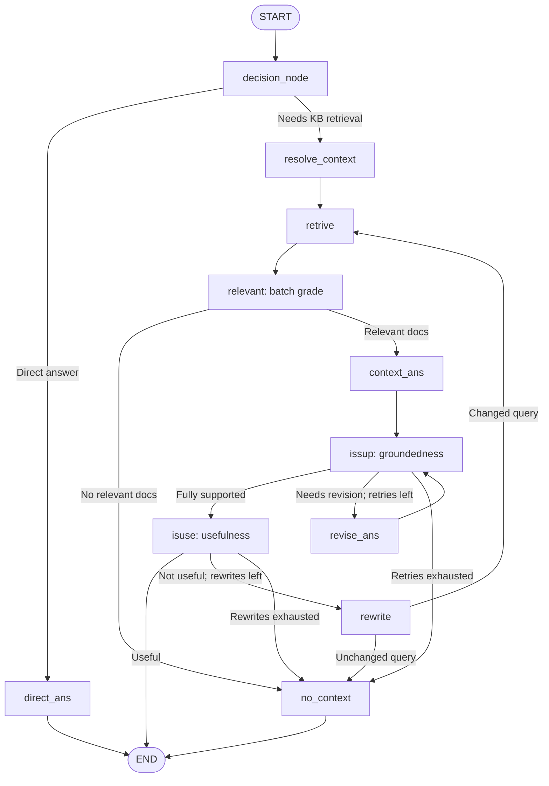

# Self-Corrective RAG Engine · v2.0

**A conversational, self-corrective RAG backend for an interactive developer portfolio.** Built with **LangGraph**, **FastAPI**, **Pinecone**, **Google Gemini embeddings**, and **two independently configured Groq clients** for generation and evaluation.

The assistant answers questions about projects, technical skills, and engineering experience using a curated PDF knowledge base. It resolves contextual follow-ups, filters retrieved evidence, checks whether generated claims are supported, and revises or rewrites when necessary. If reliable evidence is unavailable, it returns a clear fallback rather than inventing facts.

> **Release scope:** v2.0 backend. The website frontend is maintained in a separate repository. The `/chat` endpoint is the recommended integration path; token streaming is experimental and is **not** considered release-ready.

## Highlights

- **Conversational retrieval:** LangGraph checkpointing and a `thread_id` preserve recent user/assistant turns; a context-resolution node turns follow-ups such as “What technologies does it use?” into standalone retrieval queries.
- **Conditional orchestration:** Greeting/general questions can be answered directly; portfolio-specific questions go through retrieval and evaluation.
- **Evidence-aware answers:** Pinecone similarity retrieval (`k=4`), one-call batch document relevance grading, grounded answer generation, and groundedness verification.
- **Two correction loops:** Unsupported drafts can be revised; unhelpful answers can trigger query rewriting and another retrieval. Bounded retries and unchanged-query detection avoid runaway cycles.
- **Dual-Groq workload allocation:** One configurable Groq client for responses/revisions and another for routing, grading, and rewriting. Separate keys may have different quotas **only when their underlying organizations/allocations are separate**.
- **Safe failure mode:** No relevant evidence or exhausted correction attempts produce a transparent fallback.
- **Knowledge-base versioning:** Pinecone namespaces isolate the v2 data. An explicit, confirmed namespace-replacement option is available for ingestion.

## Architecture



> Node identifiers (`retrive`, `issup`, `isuse`) follow the existing implementation. The diagram shows intended routes; it does not imply every possible route has been exercised in a live test.

### Request lifecycle

1. **`decision_node`** decides whether the question needs portfolio-specific evidence, considering recent conversation history.
2. **`resolve_context`** resolves pronouns and topic references before retrieval when prior history is available.
3. **`retrive`** searches the configured Pinecone namespace using Gemini embeddings; **`relevant`** batch-grades the returned passages in one structured-output request.
4. **`context_ans`** generates an answer from accepted context; **`issup`** checks factual grounding and **`revise_ans`** can repair unsupported responses.
5. **`isuse`** checks whether the response addresses the resolved user intent; **`rewrite`** can retry retrieval when necessary. `no_context` handles unverifiable requests.
6. A successful or fallback response is added to a bounded `chat_history` list for the session.

## Technology stack

| Layer | Technology |
| --- | --- |
| API | FastAPI, Uvicorn, Pydantic v2, SlowAPI |
| Orchestration and checkpointing | LangGraph, `MemorySaver` |
| Primary generation and revision | Groq ChatGroq (configurable model) |
| Routing, grading, query rewriting | Secondary Groq ChatGroq (configurable model) |
| Embeddings | Google `gemini-embedding-001` (configurable) |
| Vector store | Pinecone via `langchain-pinecone` |
| Knowledge-base processing | PyPDFLoader, RecursiveCharacterTextSplitter |
| Client | Separate portfolio frontend using the JSON `/chat` API |

## Repository layout

```text
self_rag_engine/
├── main.py               # FastAPI routes, request limits and error handling
├── graph.py              # LangGraph nodes, state transitions and memory
├── schemas.py            # Graph state and Pydantic models
├── prompts.py            # Routing, retrieval, generation and grading prompts
├── retriever.py          # Pinecone retriever initialization
├── ingest.py             # PDF chunking and optional namespace refresh
├── config.py             # Environment-driven configuration
├── requirements.txt
├── README.md
├── .gitignore
├── .env.example           # Add this template; never include real credentials
├── assets/                # Optional diagrams/screenshots
└── tests/                 # Optional maintained tests/diagnostic scripts
```

The `assets/`, `tests/`, and `.env.example` entries represent the **recommended repository layout**, not a claim that those paths already exist. Keeping the Python application modules at the root is intentional.

## Local setup

**Requirements:** Python 3.12 (used in local testing), a Pinecone index with the correct vector dimension, and API keys for both Groq clients, Google embeddings, and Pinecone.

```powershell
# Windows PowerShell
py -m venv .venv
.\.venv\Scripts\Activate.ps1
pip install -r requirements.txt
```

Create a local `.env` based on this example (**do not commit actual keys**):

```dotenv
# Groq: generation / revision
GROQ_API_KEY=replace_with_primary_key
GROQ_MODEL=openai/gpt-oss-120b

# Groq: evaluation / routing
GROQ_EVAL_API_KEY=replace_with_secondary_key
GROQ_EVAL_MODEL=openai/gpt-oss-120b

# Gemini embeddings (chat generation is handled by Groq)
GOOGLE_API_KEY=replace_with_google_key
EMBEDDING_MODEL=gemini-embedding-001

# Pinecone
PINECONE_API_KEY=replace_with_pinecone_key
PINECONE_INDEX_NAME=portfolio-knowledge-base
PINECONE_NAMESPACE=portfolio-kb-v2-staging

# Local PDF used by the ingestion script
DATA_FILE_PATH=Navnit_Kumar_Yadav_Master_Knowledge_Base_v2.pdf
```

Configure the PDF path to match your local file. The knowledge-base PDF does **not** have to be public in this repository; see [Data and privacy](#data-and-privacy).

### Index / refresh the knowledge base

```powershell
# Add/update chunks in the currently configured namespace
py ingest.py
```

The v2 ingestion script extracts text from the PDF, splits it into overlapping chunks, generates repeatable IDs and uploads embeddings to Pinecone. The most recent local run reported **47 uploaded chunks** to `portfolio-knowledge-base/portfolio-kb-v2-staging`.

**Optional destructive replacement** — **only** if you are intentionally replacing that namespace's contents:

```powershell
py ingest.py --replace-namespace --confirm-namespace portfolio-kb-v2-staging
```

This command deletes **all vectors in the specified namespace** before uploading the new chunks; it does **not** delete the whole index or reset LangGraph chat history. Back up important vectors first. If upload fails after deletion, the namespace may be empty or partially populated until recovery. For critical deployments, prefer uploading to a **new** namespace, testing it, switching the deployment, and deleting the old namespace later.

After changing namespace/environment configuration, restart the API process.

### Start the API

```powershell
py -m uvicorn main:app --host 127.0.0.1 --port 8000
```

The docs UI is available at `http://127.0.0.1:8000/docs` in local development.

## API

### `GET /`

Lightweight health response identifying the service as online. This does not verify external provider availability.

### `POST /chat` — recommended

**Request**

```json
{
  "question": "Tell me about NeuroScan AI.",
  "thread_id": "demo-session-001"
}
```

**Response**

```json
{
  "answer": "..."
}
```

Use the **same** `thread_id` for follow-ups. A nonempty `thread_id` is required; requests without one are rejected by Pydantic validation (HTTP 422). Client-generated random identifiers reduce accidental collisions but are **not** user authentication.

**PowerShell example:**

```powershell
Invoke-RestMethod -Uri "http://127.0.0.1:8000/chat" -Method POST -ContentType "application/json" -Body '{"question":"What technologies does it use?","thread_id":"demo-session-001"}'
```

Send an initial project question in that session before using an ambiguous follow-up.

### `POST /chat/stream` — experimental

A Server-Sent Events (SSE) route exists in the codebase, but token streaming and post-verification UI behavior have **not** been validated for v2.0. Use `/chat` in the frontend until streaming is hardened; emitting a draft before groundedness verification can expose a response the graph later rejects.

**Rate limit:** The currently configured API limit is **10 requests/minute per client IP** for chat endpoints; model-provider RPM/TPM/daily quotas also apply. Errors in the RAG pipeline are returned as a generic HTTP 503 from `/chat`.

## Local validation results

Results below are **developer-observed local runs**, not controlled benchmarks or guaranteed production SLOs.

| Scenario | Observed outcome |
| --- | --- |
| NeuroScan AI project question | Retrieved relevant passages; answer assessed `fully_supported` and `useful`; HTTP 200 |
| Follow-up: “What technologies does it use?” | Query resolved to NeuroScan AI; grounded and useful answer; HTTP 200 |
| Topic switch: Credit Card Fraud Detection Engine | New project retrieved correctly without inheriting NeuroScan as the target |
| Fraud-engine follow-up | Returned imputation, scaling, encoding, SMOTE and XGBoost; HTTP 200 |
| Unsupported salary/employment question | 0/4 retrieved passages marked relevant; safe fallback; HTTP 200 |
| Query rewrite routing | Offline checks covered unchanged queries and bounded rewrite attempts |
| Batch relevance grading | Structured JSON output tested, including four `false` decisions |

**Latency observations:** Four successful project/follow-up requests completed in approximately **9.09–9.70 seconds** each; one unsupported-question fallback completed in approximately **4.48 seconds**. Timing depends on network, provider load, and document content.

### Smoke-test checklist

1. Ask about a named project using a fresh `thread_id`.
2. Follow up with “What technologies does it use?” using **the same** `thread_id`.
3. Switch explicitly to another project, then ask a follow-up.
4. Ask an unsupported question and confirm the answer does not invent facts.
5. Inspect graph logs for routing, relevance counts, grounding, usefulness and final response status.

Existing `test.py`, `test_schema.py`, and `test_rewrite.py` are primarily **manual diagnostic scripts**, not a comprehensive automated test suite.

## Data and privacy

- The master PDF may contain personal contact details and project-reported metrics. **Do not publish an unsanitized PDF** or expose its raw contents if you don't intend that data to be public.
- The assistant prompt tells the model not to disclose personal contact details, but **prompt instructions are not an access-control boundary**. Sanitize sensitive information **before ingestion** if confidentiality is required.
- `MemorySaver` is **process-local**: sessions will disappear on restart, and state is not shared reliably across multiple worker processes. It is appropriate for a lightweight demo, not persistent multi-instance production history.
- `thread_id` is an identifier, **not an authorization mechanism**. Additional session isolation and authentication controls are future hardening tasks.
- Current CORS configuration allows all origins (`*`); restrict origins before deploying endpoints that require stronger browser access controls.
- Do not commit `.env`, credentials, sensitive logs, or generated cache directories.

## Known limitations / roadmap

- **v2.0:** Tested conversational retrieval, batch relevance grading, groundedness/usefulness loops, and fallback behavior. Retrieval retry paths are bounded, but not every edge case is covered by automated integration tests.
- **Future patch:** More robust session isolation, authentication, CORS and persistent checkpointing.
- **Future patch:** Robust streaming of the **final approved answer** or another client protocol that can reconcile revised drafts.
- **Future patch:** More extensive automated tests, runtime metrics and multi-sample latency benchmarking.

## License

No license is declared by this README. Add a `LICENSE` file if you want to explicitly grant reuse rights.
